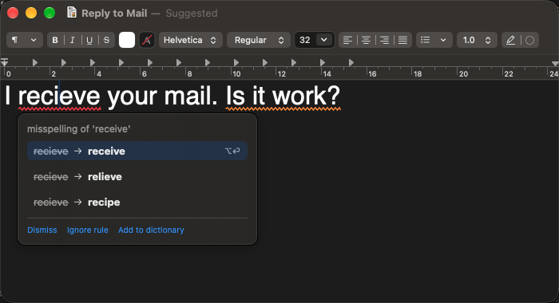
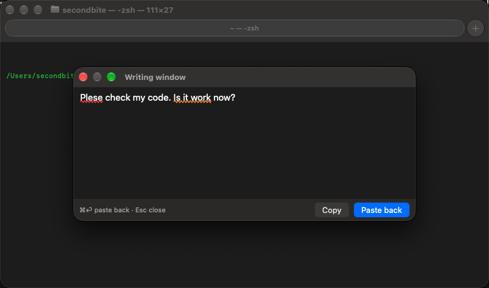
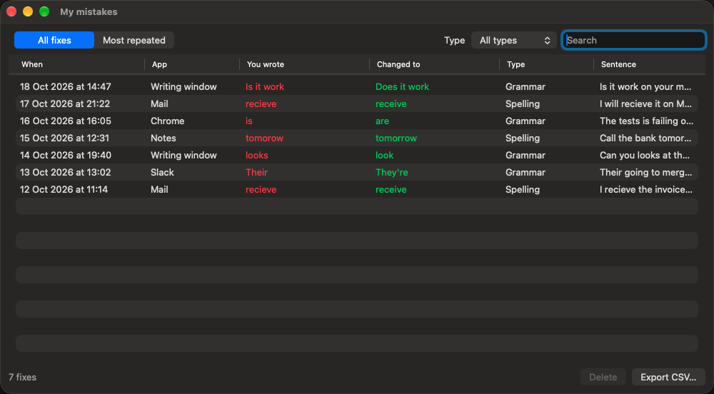

# Writing Assistant

A personal Grammarly replacement for macOS. It lives in the menu bar, watches what you type in any app, and underlines mistakes as you go. Click an underline (or press ⌥⏎) to fix it. Every fix you accept is saved to a private log on your Mac, so you can see which mistakes you keep making.

## How it works, in four pictures

**1. Type anywhere, and mistakes get underlined.** Two kinds of fixes:

- **Word fix**, a red line under one word: "recieve" → "receive". Found instantly, on your Mac.
- **Whole-sentence fix**, an orange line under the whole sentence: "Is it work?" → "Does it work?". Every word is spelled right, but the sentence is wrong. An AI model catches these.


**2. Click an underline to see the fix.** A small card shows the fix. Click it to apply it, or put the cursor in the word and press ⌥⏎.



**3. In a terminal, use the Writing window.** Terminals (cmux, Terminal, iTerm) can't be checked directly. Press ⌃⌥Space to open a small window that stays on top, write there with full checking, then press ⌘⏎ to paste the text back where you were (or click Copy).



**4. See every fix you accepted.** Menu bar icon → "My mistakes…" lists every fix with the app and the sentence, a "Most repeated" view, search, a type filter, delete and CSV export.



## Shortcuts

| Keys | What it does |
| --- | --- |
| ⌥⏎ | Accept the fix under the cursor |
| ⌃⌥Space | Open or close the Writing window |
| ⌘⏎ (in the Writing window) | Paste the text back into the app you came from |
| Esc (in the Writing window) | Close it and keep the draft |

## What's under the hood

- **Tier 1, on your Mac:** [Harper](https://writewithharper.com) checks spelling and grammar locally, in milliseconds, for free.
- **Tier 2, AI:** sentences go to an AI model via OpenRouter (`deepseek/deepseek-v4-flash`, falling back to `minimax/minimax-m3`). This happens only right after you type, so it costs a few dollars a month at most.
- **Mistake log:** a SQLite file on your Mac (`mistakes.sqlite`). It can be turned off in the menu ("Save accepted fixes").
- **Privacy:** no accounts, no server of its own. Diagnostic logs never contain your text.

## Build and install

```bash
export DEVELOPER_DIR=/Applications/Xcode.app/Contents/Developer
scripts/install.sh            # builds and installs /Applications/WritingAssistant.app
```

The first time it runs, allow it in System Settings → Privacy & Security → Accessibility. Add your OpenRouter key from the menu ("Set OpenRouter Key…").

## More

- [DESIGN.md](DESIGN.md): what it does and why.
- [PLAN.md](PLAN.md): milestones and the test list for each one.
- [docs/decisions/](docs/decisions/): every non-obvious choice, one file each.
- The screenshots are made by `scripts/readme-shots.py` with sample text.
