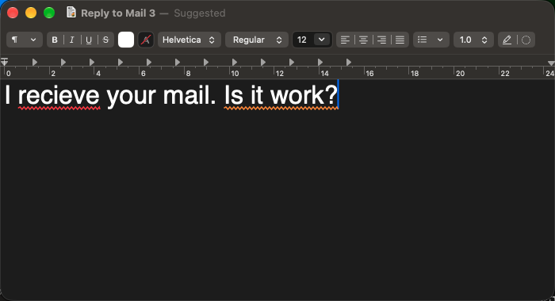
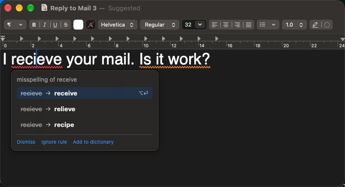
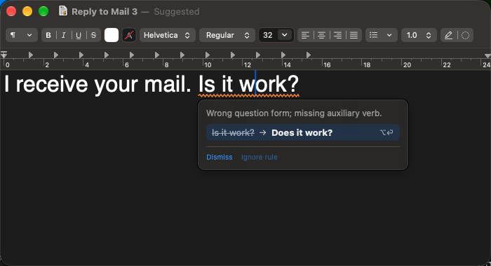
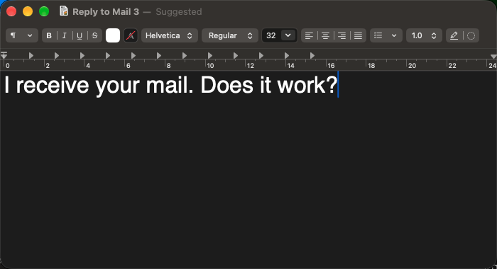
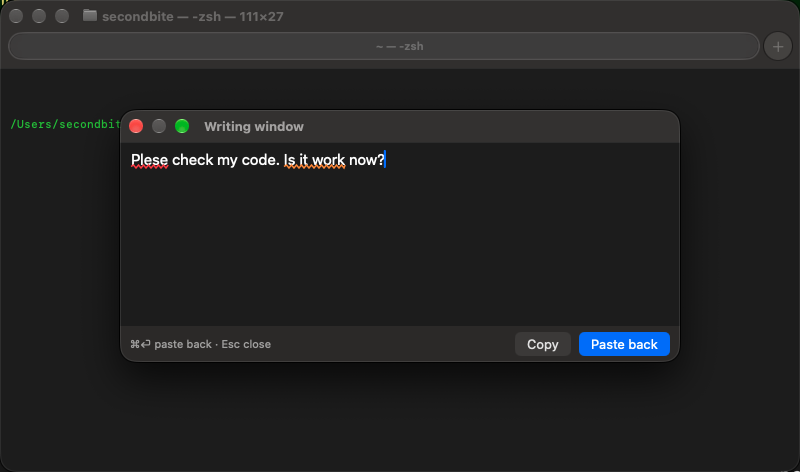
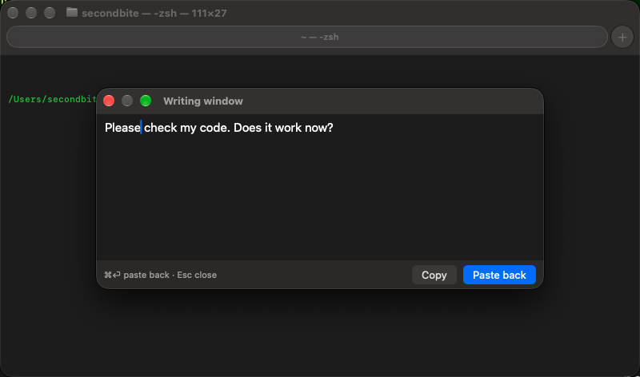
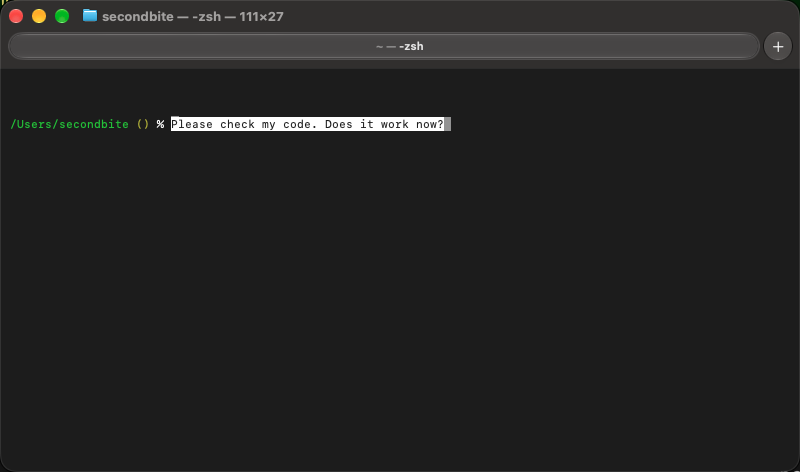
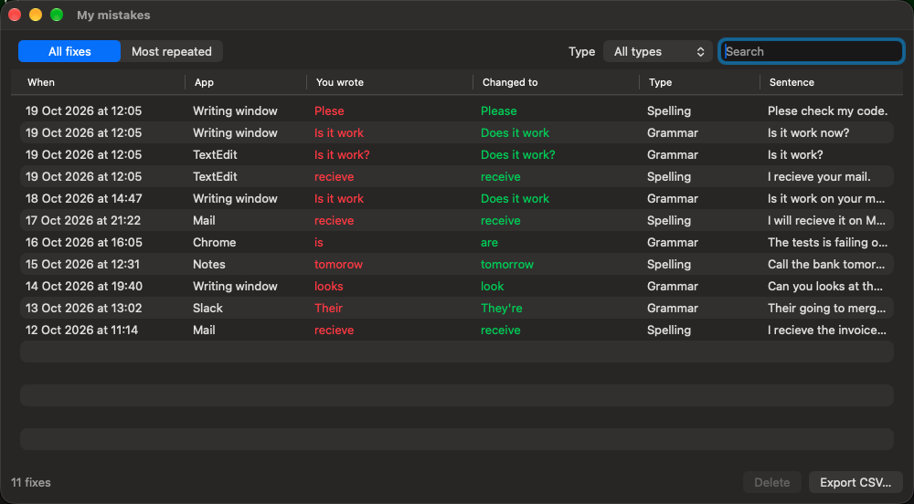

# Writing Assistant

A personal Grammarly alternative for macOS. It lives in the menu bar, watches what you type in any app, and underlines mistakes as you go. Click an underline (or press ⌥⏎) to fix it. Every fix you accept is saved to a private log on your Mac, so you can see which mistakes you keep making.

## How it works

There are two kinds of fixes:

- **Word fix:** one word is wrong. "recieve" → "receive". A red line goes under the word. Found instantly, on your Mac.
- **Whole-sentence fix:** every word is spelled right, but the sentence is wrong. "Is it work?" → "Does it work?". An orange line goes under the sentence. An AI model finds these.

### Story 1: writing in a normal app (Mail, Notes, Slack, Chrome, TextEdit…)

**Step 1. You type.** Both mistakes get underlined.



**Step 2. Click the red word.** A card shows the fix. Click it (or press ⌥⏎).



**Step 3. Click the orange sentence.** A card shows the whole sentence, fixed. Click it.



**Step 4. Done.** Both fixes are in your text.



### Story 2: writing in a terminal (cmux, Terminal, iTerm)

The app can't check text inside a terminal directly. So you write in the Writing window instead.

**Step 1. Press ⌃⌥Space and type.** A small window opens on top of the terminal. Mistakes get underlined there.



**Step 2. Fix them.** Put the cursor in a mistake and press ⌥⏎ (or click the underline).



**Step 3. Press ⌘⏎.** The window closes and the fixed text is pasted at your terminal prompt. Nothing runs until you press Enter. (Or click Copy instead.)



### Then: see every fix you accepted

Menu bar icon → "My mistakes…". Every fix is saved: what you wrote, what it changed to, the app, and the sentence. The fixes from both stories are at the top. You can search, filter by type, see your most repeated mistakes, delete rows, and export to CSV.



## Shortcuts

| Keys | What it does |
| --- | --- |
| ⌥⏎ | Accept the fix under the cursor |
| ⌃⌥Space | Open or close the Writing window |
| ⌘⏎ (in the Writing window) | Paste the text back into the app you came from |
| Esc (in the Writing window) | Close it and keep the draft |

## Architecture

### The big picture

Everything runs inside one menu-bar app on your Mac. The only thing that leaves your Mac is a finished sentence sent to the AI model.

```
                     You type in any app (Mail, Slack, Chrome, TextEdit…)
                                         │
                                         │  macOS Accessibility: "the text in this field changed"
                                         ▼
 ┌───────────────────────────── Writing Assistant (menu-bar app) ──────────────────────────────┐
 │                                                                                             │
 │   ┌──────────────────┐        ┌──────────────────┐                                          │
 │   │ 1. Focus tracker │ ─────► │ 2. Checker       │                                          │
 │   │ which text box,  │        │ splits sentences,│                                          │
 │   │ its text, where  │        │ waits 400 ms     │                                          │
 │   │ words are drawn  │        │ after you stop   │                                          │
 │   └──────────────────┘        └───┬──────────┬───┘                                          │
 │                                   │          │  only finished sentences,                    │
 │                                   │          │  only within 10 s of a key press             │
 │                                   ▼          ▼                                              │
 │                  ┌─────────────────┐    ┌─────────────────┐                                 │
 │                  │ 3a. Tier 1      │    │ 3b. Tier 2      │         ┌────────────────────┐  │
 │                  │ Harper          │    │ AI model        │ ◄─────► │ OpenRouter (cloud) │  │
 │                  │ on your Mac     │    │ whole-sentence  │         │ deepseek-v4-flash  │  │
 │                  │ word fixes      │    │ fixes           │         │ fallback minimax-m3│  │
 │                  └────────┬────────┘    └────────┬────────┘         └────────────────────┘  │
 │                           └──────────┬───────────┘                                          │
 │                                      ▼                                                      │
 │                         ┌──────────────────────────┐                                        │
 │                         │ 4. Overlay               │  see-through window on top of the app, │
 │                         │ draws the underlines     │  so the app's text is never touched    │
 │                         └────────────┬─────────────┘                                        │
 │                                      │  you click an underline, or press ⌥⏎                 │
 │                                      ▼                                                      │
 │                         ┌──────────────────────────┐                                        │
 │                         │ 5. Card + Applier        │  writes the fix into the app           │
 │                         │                          │  (Accessibility; paste if that fails)  │
 │                         └────────────┬─────────────┘                                        │
 │                                      ▼                                                      │
 │                         ┌──────────────────────────┐        ┌──────────────────────┐        │
 │                         │ 6. Mistake log (SQLite)  │ ─────► │ "My mistakes" window │        │
 │                         └──────────────────────────┘        └──────────────────────┘        │
 └─────────────────────────────────────────────────────────────────────────────────────────────┘
```

### One sentence, step by step

You type `I recieve your mail. Is it work?` in Mail.

1. **Focus tracker** sees the text change (macOS Accessibility tells it), and reads the text and where each word is on screen.
2. **Checker** splits the text into sentences. It waits until you stop typing for 400 ms, and only re-checks sentences that changed.
3. **Tier 1 (Harper)** checks every changed sentence on your Mac, instantly and for free. It finds `recieve`.
4. **Tier 2 (AI)** gets a sentence only when it looks finished (ends in `.` `?` `!` and your cursor has left it), and only if you pressed a key or clicked in the last 10 seconds. It finds `Is it work?` → `Does it work?`.
5. **Overlay** draws both underlines in a see-through window that sits exactly over Mail.
6. You click an underline. The **card** shows the fix. You click it (or press ⌥⏎).
7. **Applier** writes the fix into Mail through Accessibility. If Mail ignores that, it pastes the fix instead and puts your clipboard back.
8. **Mistake log** saves a row: what you wrote, the fix, the app and the sentence. "My mistakes" shows it.

### The Writing window (for terminals)

Terminals don't give a usable text box to Accessibility, so the app doesn't check them at all. Instead you write in a window that belongs to the app itself, and it goes through the same steps 1–8 as any other app.

```
   Terminal / cmux                                   Writing window (part of the app)
   ┌──────────────────────┐      ⌃⌥Space opens       ┌────────────────────────────┐
   │ % _                  │ ───────────────────────► │ Plese check my code.       │
   │                      │                          │ Is it work now?            │
   │                      │                          │    (checked: steps 1–8)    │
   │ % Please check my    │ ◄─────────────────────── │ ⌘⏎ Paste back · Copy · Esc │
   │   code. Does it work │   ⌘⏎: pastes the text,   └────────────────────────────┘
   │   now?               │   gives your clipboard back.
   └──────────────────────┘   Nothing runs until you press Enter.
```

It stays on top of every window, on every desktop.

### Where the code is

| Folder | What's inside |
| --- | --- |
| `App/` | The menu-bar app: checker, overlay, card, applier, Writing window, "My mistakes" window, Harper and OpenRouter clients |
| `AXKit/` | Talking to macOS Accessibility: following the focused text box, reading its text and word positions |
| `Core/` | Pure logic with no UI and no network, unit-tested: sentences, suggestions, the AI request and reply, the tier-2 scheduler, the mistake log |
| `Fixtures/` | A small test app the automated tests type into |
| `scripts/` | Install script and end-to-end tests that drive the real installed app |
| `docs/decisions/` | One file per design choice, with the reason |

### Privacy and cost

- Password fields are never read.
- Tier 1 never leaves your Mac. Tier 2 sends only the finished sentence and the sentence on each side.
- Tier 2 runs only right after you type or click, and there's a daily request cap, so the AI bill stays small.
- Diagnostic logs never contain your text. The mistake log is the one exception: it's a local file you can switch off in the menu ("Save accepted fixes").

## Build and install

```bash
export DEVELOPER_DIR=/Applications/Xcode.app/Contents/Developer
scripts/install.sh            # builds and installs /Applications/WritingAssistant.app
```

The first time it runs, allow it in System Settings → Privacy & Security → Accessibility. Add your OpenRouter key from the menu ("Set OpenRouter Key…").

## More

- [DESIGN.md](DESIGN.md): what it does and why.
- [PLAN.md](PLAN.md): milestones and the test list for each one.
- [docs/decisions/](docs/decisions/): every non-obvious choice, one file each.
- The screenshots are made by `scripts/readme-shots.py` with sample text.
